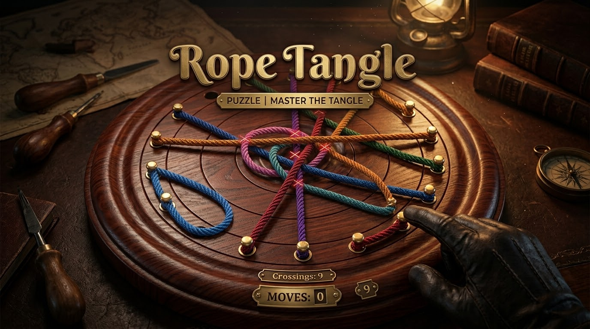

# 🪢 Rope Tangle Puzzle

<p align="center">
  <a href="https://github.com/leonardoconstantino/rope-tangle-puzzle/actions/workflows/deploy.yml">
    
  </a>
  
  
  
  
  
</p>

<p align="center">
  <strong>Um quebra-cabeça tátil e relaxante onde você desemaranha cordas com física realista sobre tabuleiros de madeira artesanal torneada.</strong>
</p>

<p align="center">
  🎮 <strong><a href="https://leonardoconstantino.github.io/rope-tangle-puzzle/">Jogue agora no GitHub Pages</a></strong> 🎮
</p>

---

<p align="center">
  
</p>

---

## ✨ Recursos Principais

- 🧵 **Física de Cordas Realista**: Dinâmica de fios com integração Verlet, tensão elástica, rigidez e amortecimento tátil ao puxar ou soltar pinos.
- 🪵 **Tabuleiros Artesanais em Madeira**: Renderização em Canvas 2D com chanfros, veios de madeira, anéis de torno e múltiplas formas geométricas:
  - **Círculo Clássico**
  - **Octógono Lapidado**
  - **Estrela de 16 Pontas**
- 🎨 **Temas Visuais Colecionáveis**:
  - *Classic Wood* (Mogno e cerejeira artesanal)
  - *Nordic Birch* (Madeira clara escandinava com tons pastéis)
  - *Midnight Ebony* (Madeira nobre escura com neon sutil)
  - *Rich Mahogany* (Acabamento laqueado profundo)
  - *Arctic Frost* (Superfície gélida minimalista)
- 🧠 **Modos de Jogo**:
  - **Modo Campanha / Níveis**: Dificuldades progressivas de Fácil (4 cordas) a Mestre (10+ cordas).
  - **Desafio Diário (Daily Puzzle)**: Um novo desafio todos os dias gerado por semente determinística com contador de sequências (streak).
  - **Modo Livre Zen**: Pratique sem limites de tempo ou movimentos.
- 💡 **Sistema de Dicas Inteligentes**: Algoritmo que calcula o movimento ótimo para reduzir o maior número de cruzamentos instantaneamente.
- 🔊 **Áudio Sintetizado com Web Audio API**: Sons procedurais de encaixe de pinos em furos ocos, atrito de cordas esticadas, cliques de botões e fanfarra harmônica de vitória.
- 📱 **100% Responsivo e Touch-First**: Funciona de forma idêntica e fluida tanto em computadores (mouse) quanto em smartphones e tablets (toque).

---

## 🎯 Como Jogar

1. **Objetivo**: Desfaça todos os nós e cruzamentos até que **nenhuma corda encoste ou cruze sobre outra**.
2. **Identificação**:
   - 🔴 **Corda Vermelha/Pulsante**: Possui cruzamentos ativos com outras cordas.
   - 🟢 **Corda Verde Dourada**: Livre de cruzamentos e relaxada.
3. **Mecânica**:
   - Toque ou clique em um dos **pinos dourados/metálicos** nas extremidades de uma corda.
   - Arraste o pino até outro **orifício livre** do tabuleiro.
   - Solte para fixar o pino. Se a nova posição reduzir os cruzamentos, você avança rumo à vitória!
4. **Vitória**: Quando todas as cordas estiverem livres de interseções, a fase é concluída com comemoração e estatísticas de tempo e movimentos.

---

## 🚀 Como Rodar Localmente

### Pré-requisitos
- [Node.js](https://nodejs.org/) versão 18 ou 20+
- Gerenciador de pacotes `npm` ou `bun`

### Passo a Passo

1. **Clone o repositório:**
   ```bash
   git clone https://github.com/leonardoconstantino/rope-tangle-puzzle.git
   cd rope-tangle-puzzle
   ```

2. **Instale as dependências:**
   ```bash
   npm install
   ```

3. **Inicie o servidor de desenvolvimento:**
   ```bash
   npm run dev
   ```
   Abra seu navegador em `http://localhost:3000`.

4. **Gerar a build de produção:**
   ```bash
   npm run build
   ```

---

## ⚙️ Deploy Automático no GitHub Pages

Este repositório possui integração contínua (CI/CD) configurada via **GitHub Actions** em [`.github/workflows/deploy.yml`](.github/workflows/deploy.yml).

### Fluxo de Funcionamento:
1. Sempre que houver um `push` na branch `main` ou `master` (ou acionamento manual via `workflow_dispatch`), o GitHub Actions inicia a automação.
2. O ambiente instala as dependências, define `GITHUB_ACTIONS=true` e executa `npm run build`.
3. O `vite.config.ts` injeta automaticamente o caminho base `/rope-tangle-puzzle/`.
4. Os artefatos estáticos em `./dist` são empacotados e publicados diretamente no **GitHub Pages**.

---

## 📄 Licença

Distribuído sob a licença MIT. Consulte o arquivo de licença para mais detalhes.
